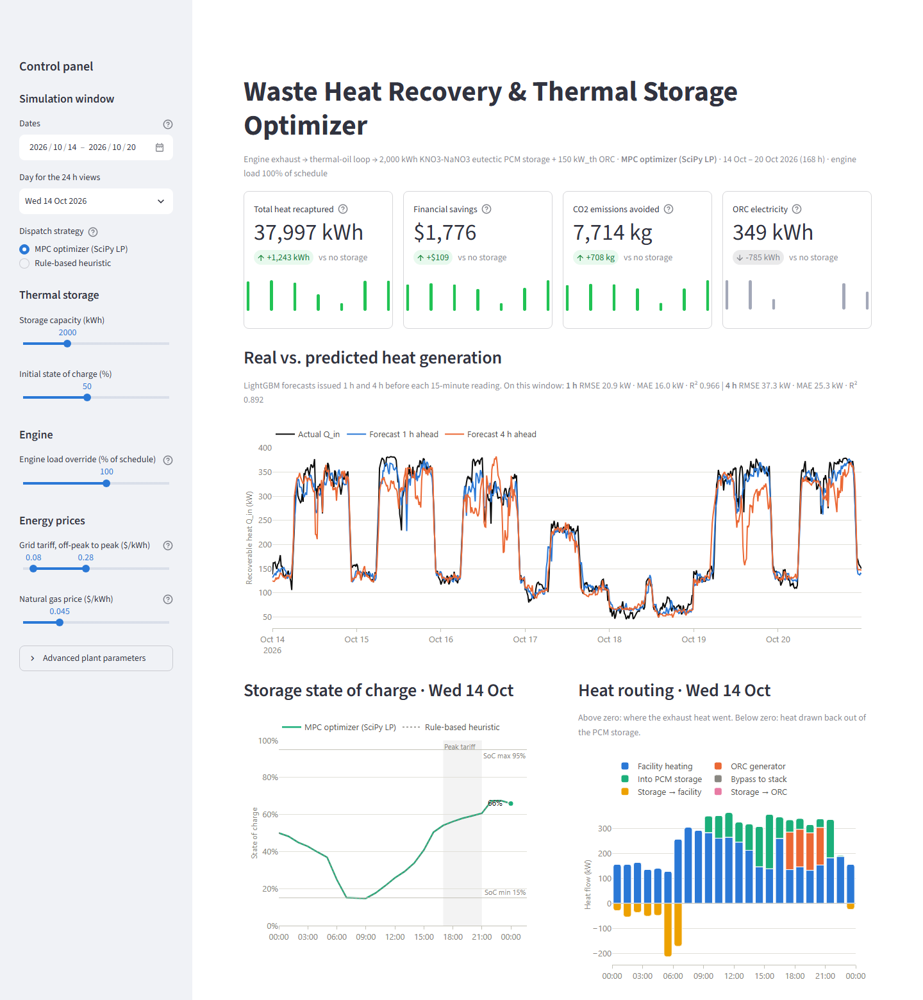

# Waste Heat Recovery & Thermal Storage Optimizer

End-to-end ML + optimization project for an industrial engine's exhaust **waste heat recovery (WHR)** plant: a LightGBM model forecasts the recoverable heat 1 h and 4 h ahead, a PCM thermal storage model tracks the state of charge, a receding-horizon linear programme (SciPy / HiGHS) routes the heat every hour, and a Streamlit dashboard lets you change storage size, engine load and energy prices and see the result immediately.



## Run it

### One click

| OS | Command |
|---|---|
| Windows | double-click **`run_all.bat`** (or run it from a terminal) |
| macOS / Linux | `bash run_all.sh` |

The script creates a `.venv`, installs `requirements.txt`, generates the dataset, trains the model and opens the dashboard on <http://localhost:8501>. The first install downloads about 200 MB; later runs take about 10 seconds before the dashboard opens.

### Step by step

Windows (PowerShell):

```powershell
python -m venv .venv
.venv\Scripts\python -m pip install -r requirements.txt
.venv\Scripts\python dataset_builder.py      # -> factory_sensor_data.csv
.venv\Scripts\python train_model.py          # -> heat_forecaster.pkl + metrics in the console
.venv\Scripts\python storage_simulator.py    # optional: 24 h storage demo + energy-balance check
.venv\Scripts\python optimizer.py            # optional: hold-out week, MPC vs rule-based
.venv\Scripts\python -m streamlit run app.py
```

macOS / Linux: same commands with `python3 -m venv .venv` and `.venv/bin/python`.

`app.py` also generates the CSV and trains the model by itself if they are missing.

## Files

| File | What it does |
|---|---|
| `dataset_builder.py` | 30 days × 15 min of telemetry (2,880 rows): rpm, load, exhaust temperature and flow, ambient temperature, time-of-use grid price, facility heat demand, and ground-truth `q_in_kw = m_dot · Cp · (T_exhaust − T_ambient)`. Includes two-shift production schedule, thermal lag of the exhaust, rush orders, unplanned trips and process batches. |
| `train_model.py` | Causal feature engineering (rolling mean/std over 15 min, 1 h, 4 h; dT/dt gradients; cyclic hour/day features for origin and target time; same-time-yesterday lags), one LightGBM model per horizon, purged chronological split, walk-forward CV, comparison with naive baselines, `joblib` bundle. |
| `storage_simulator.py` | `ThermalStorageBuffer`: 2,000 kWh KNO3–NaNO3 PCM tank, 90 % charge / 90 % discharge efficiency, SoC window 15–95 %, standing loss `U·A·(T_storage − T_ambient)` with a PCM temperature curve (solid → melting plateau at 222 °C → liquid). Methods `charge()`, `discharge()`, `get_soc()`, `apply_standing_loss()`, `step()`. |
| `optimizer.py` | Hourly heat dispatcher with two strategies behind one `decide(predicted_q_in_kw, current_soc, grid_price, facility_heat_demand_kw)` interface: a **rule-based heuristic** and an **MPC** that solves a 24 h LP with `scipy.optimize.linprog` (HiGHS) and executes the first hour. Includes the closed-loop simulator, the no-storage baseline and the KPIs. |
| `app.py` | Streamlit + Plotly dashboard: KPI cards, real vs predicted heat, 24 h storage SoC, hourly heat routing, energy-balance Sankey, strategy comparison, hourly decision log (CSV download), model card. |
| `run_all.bat` / `run_all.sh` | One-click setup and launch. |

## How the dispatch works

Every hour the dispatcher receives the predicted heat, the storage SoC, the grid price and the facility heat demand, and routes the heat to:

1. **facility heating** (replaces gas burnt in the backup boiler),
2. the **ORC generator** (electricity valued at the grid price, preferred in peak hours),
3. the **PCM storage** (surplus heat),
4. **storage discharge** back to the facility, or into the ORC in peak-price hours.

The MPC uses the 1 h forecast for the next hour, the 4 h forecast for hours 2–4, and the average profile for that day type (weekday / Saturday / Sunday) and hour beyond that. It values heat left in the tank at the horizon at its facility-heating value. Decisions are made on **forecasts**; the simulator then applies them to the heat that actually arrives, so forecast errors affect the result as they would on a real plant.

## Results (hold-out week, 14–20 Oct 2026)

**Forecaster** (the 7 days were never seen in training):

| Horizon | Model | RMSE (kW) | MAE (kW) | R² |
|---|---|---|---|---|
| 1 h | LightGBM | 20.9 | 16.0 | 0.966 |
| 1 h | Persistence baseline | 49.8 | 29.3 | 0.808 |
| 4 h | LightGBM | 37.3 | 25.3 | 0.892 |
| 4 h | Persistence baseline | 108.0 | 75.2 | 0.097 |

**Dispatch** (2,000 kWh storage, 150 kW_th ORC, default prices, both strategies start at 50 % SoC):

| Strategy | Heat recaptured | Savings | CO2 avoided | Boiler heat still needed |
|---|---|---|---|---|
| MPC optimizer (LP) | 38.0 MWh (100 %) | $1,776 | 7.71 t | 3.4 MWh |
| Rule-based heuristic | 38.0 MWh (100 %) | $1,779 | 7.68 t | 3.7 MWh |
| No storage (direct + ORC) | 36.8 MWh (96.7 %) | $1,667 | 7.01 t | 7.9 MWh |

What these numbers show:

- Storage is worth about **$110 per week** at default prices. It removes the 1.24 MWh/week of bypassed heat and halves the boiler gas.
- At default prices the two strategies tie, and both are within rounding of a perfect-foresight LP over the whole week. In a 9-scenario sweep (tank size, ORC size, gas and power prices), the MPC was never meaningfully behind the rules (at worst −0.05 %). It pulled ahead where fixed rules fit the economics badly: +0.4 % with a 500 kWh tank (37 % less bypass), +1.0 % with a flat tariff, +1.2 % at a gas price of $0.09/kWh.
- With cheap gas, storage barely pays: a 222 °C tank loses about 600 kWh per week whether it is used or not.

## Assumptions and limits

- The data is **synthetic**, generated to be physically consistent. Replace `factory_sensor_data.csv` with real logs (same columns) and retrain.
- `Q_in` is referenced to **ambient** temperature, as specified, so it is an upper bound. Real heat exchangers stop at about 120–150 °C (acid dew point); change the reference in `waste_heat_kw()`.
- Exhaust Cp = 1.10 kJ/(kg·K). ORC net efficiency is a constant 15 % (no part-load curve or minimum load, so the dispatch is an LP, not a MILP).
- The storage HX rating is C/5 (400 kW for 2,000 kWh). U = 0.40 W/(m²·K), and the tank area scales with capacity^(2/3).
- Gas at $0.045/kWh_fuel and boiler efficiency 90 % make recovered heat worth $0.050/kWh. CO2 factors: gas 0.202 kg/kWh_fuel, grid 0.40 kg/kWh_e.

## Tested with

Python 3.14.5 on Windows 11: pandas 3.1.0, numpy 2.5.4, scikit-learn 1.9.1, lightgbm 4.7.0, scipy 1.18.1, streamlit 1.66.1, plotly 7.1.0. `train_model.py` falls back to scikit-learn's `HistGradientBoostingRegressor` if LightGBM is not installed.
